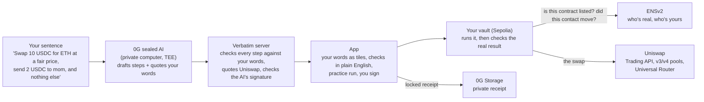

# Verbatim

**You say what you want, and that's the only thing your money can do.**

Type a payment in plain words. A sealed AI turns your words into checks, and each check quotes the words it came from. A smart-contract vault then runs the transaction and checks the real result against your words. If anything else would happen (a hacked app, a fake contract, a bad price, a stolen key reaching for more), the whole transaction never happens.

Built for ETHGlobal Mumbai 2026 by Pavitara and Mithun. Everything runs on **Ethereum Sepolia** with test money.

- **Live demo:** https://verbatim-lake.vercel.app (the server is switched on for judging). Sign in with 0G works only on `localhost`, because that's where 0G's sign-in runs.
- **Prizes entered:** ENS (Best Use of ENSv2), Uniswap (Build with Uniswap), 0G (Build with iAI).

---

## How it works



**What the vault checks on every run** ([`contracts/src/VerbatimVault.sol`](contracts/src/VerbatimVault.sol#L408), `run` from line 400):
1. **Your words:** "at most X leaves", "at least Y arrives", "exactly X to this contact". Your checks come from your sentence, not from the app. Buying something the vault can't price, like an NFT, counts as a purchase: "at least 1 print arrives", with "at most X leaves" as the price cap ([`itemBought`](contracts/src/VerbatimVault.sol#L643), [`buysOnlyFrom`](contracts/src/VerbatimVault.sol#L653)).
2. **Always on:** no borrowed code (delegatecall), only contracts listed in the ENS directory, trusted contracts can never be asked to move or approve your tokens ([`movesTokens`](contracts/src/VerbatimVault.sol#L474)), only saved contacts (pinned by ENS name), no permission left behind, nothing else leaves, a fair price from Uniswap's own pools, the daily limit and the new-contact limit.
3. **Standing rules:** a second key (your phone) approves anything that loosens a rule, and a public wait runs before it switches on.

A stolen everyday key can only do what your rules allow: pay saved contacts within today's limit. It can't add a contact or loosen a rule without your phone.

---

## ENS: who you're dealing with

Your words are made of names: "swap on Uniswap", "send 2 to mom". ENS makes each name mean exactly one address, and **the vault checks that itself while your transaction runs**, so no app can swap the address.

1. **Who's real: the official directory.** Each organization owns a name like `router.uniswap.verbatim.eth`, with its own Permissioned Registry and Permissioned Resolver; its key can edit only its own records (Enhanced Access Control). The directory is emancipated: no key, not even ours, can change another organization's name. During every transaction that calls a contract, the vault reads the directory through ENSv2's Universal Resolver and checks the resolver is a genuine Permissioned Resolver (Verifiable Factory). Wildcards, resolvers that aren't genuine and expired names count as "not trusted".
2. **Who's yours: contacts are names.** Your phone names a contact while saving it: paste an address, type a name, and it creates `ravi.yourname.eth`, points it at the address and saves it in the vault. Every payment re-reads the name; if it moved, the payment never happens until your phone approves the new address.
3. **Temporary contacts: expiring subnames.** Choose how long a contact lasts: a day, a week, a month, or a number of days. After its end date, payments to it never happen until your phone renews it, and **End now** ends it early. A freelancer hired for one week stops by themselves.
4. **Who you are: your name is your vault.** Your rules are published on it as text records, and only the vault can write them.

*In the demo we play Uniswap, Circle and our print shop with keys we generated. In real life each organization runs its own name.*

| What | Where |
|---|---|
| The vault refuses unlisted contracts | `contracts/src/VerbatimVault.sol`: [`inspectOne`](contracts/src/VerbatimVault.sol#L439) from line 431, ["Not a trusted contract"](contracts/src/VerbatimVault.sol#L470) at line 462, [`isKnown`](contracts/src/VerbatimVault.sol#L481) at line 473 |
| Reading ENSv2 during the transaction | `contracts/src/EnsDirectory.sol`: [`read`](contracts/src/EnsDirectory.sol#L134) at line 134 (Universal Resolver), [`isGenuine`](contracts/src/EnsDirectory.sol#L150) at line 150 (Verifiable Factory), [`isListed`](contracts/src/EnsDirectory.sol#L113) / [`listed`](contracts/src/EnsDirectory.sol#L121) at lines 113 and 121 |
| Contacts as names, re-read on every payment | `VerbatimVault.sol`: [`saveContactName`](contracts/src/VerbatimVault.sol#L174) at line 174, [`requireSameAddress`](contracts/src/VerbatimVault.sol#L211) at line 211 |
| Rules published to your name | `VerbatimVault.sol`: [`setEnsName`](contracts/src/VerbatimVault.sol#L257) at line 257, [`publish`](contracts/src/VerbatimVault.sol#L203) at line 203; records built by [`EnsDirectory.records`](contracts/src/EnsDirectory.sol#L98) at line 98 |
| Naming a contact while saving it, and how long it lasts | `SaveContact` in [`app/src/Phone.jsx`](app/src/Phone.jsx) |
| Temporary contacts: end dates, **End now** (`unregister`) and **Renew**, only for your phone's key | `ContactRow` in [`app/src/Phone.jsx`](app/src/Phone.jsx); [`nameEnd`](app/src/chain.js#L128) in `app/src/chain.js`; 8 fork tests on real Sepolia ENS in [`contracts/test/TemporaryContactsFork.t.sol`](contracts/test/TemporaryContactsFork.t.sol) |
| Expiry: an expired contact name can't be paid, expired directory names stop counting | [`contracts/test/ContactNamesFork.t.sol`](contracts/test/ContactNamesFork.t.sol) (two fork tests) |
| The directory setup (own registries and resolvers, emancipated) | [`server/scripts/directory.js`](server/scripts/directory.js), `setupDirectory`; resolvers through the Verifiable Factory in [`server/scripts/ens.js`](server/scripts/ens.js) |
| The fake-router attack, refused because ENS says it isn't Uniswap | [`app/src/demo.js`](app/src/demo.js) (`ATTACKS`) and the attack page |
| The Names page (no wallet) and the "name moved" demo | [`app/src/names.js`](app/src/names.js) (`readName`), [`app/src/Names.jsx`](app/src/Names.jsx); `ContactRow` in `app/src/Phone.jsx` |

**Remove ENS and** "swap on Uniswap" means nothing: the vault can't tell the real Uniswap from a fake, so every swap is refused, and contacts go back to bare addresses, which is exactly what scammers fake.

---

## Uniswap

| What | Where |
|---|---|
| Quotes and swaps from the Uniswap Trading API, checked before signing | `server/src/uniswap.js`: [`quoteSwap`](server/src/uniswap.js#L127) from line 127 (`/quote` at line 129, `/swap` at line 141) |
| The swap as vault actions: an exact Permit2 allowance that ends this block, then the Universal Router call | `app/src/run.js`: [`swapActions`](app/src/run.js#L67) at line 67 ([router call](app/src/run.js#L111) at line 111) |
| The real result checked against your words, and a fair price | `contracts/src/VerbatimVault.sol`: [`verify`](contracts/src/VerbatimVault.sol#L535) at line 527, [`requireNoPermissionLeft`](contracts/src/VerbatimVault.sol#L557) at line 549, [`requireFairTrade`](contracts/src/VerbatimVault.sol#L620) at line 612 |
| The fair price from Uniswap v3 pools (median of 4 pools' 2-hour averages) | `contracts/src/PoolPriceSource.sol`: [`valueOf`](contracts/src/PoolPriceSource.sol#L40) at line 40, [`medianTick`](contracts/src/PoolPriceSource.sol#L47) at line 47 |
| **A bad v4 hook, replayed live:** our own hook on a real v4 pool pays fairly when Uniswap's quoter asks and takes 20% when the swap is real | `contracts/experiments/BadHook.sol`: [`afterSwap`](contracts/experiments/BadHook.sol#L38) at line 38; [`contracts/experiments/HookPools.sol`](contracts/experiments/HookPools.sol) (PoolManager `unlock`, reset to the start price); `server/src/sepolia-replays.js`: [`quoteHook`](server/src/sepolia-replays.js#L673) at line 673 (V4Quoter), [`hookSwap`](server/src/sepolia-replays.js#L648) at line 648 (Universal Router `V4_SWAP`), [`runHook`](server/src/sepolia-replays.js#L684) at line 684 |
| The $50.4M Aave trade, replayed through copies of its Uniswap v3 and v2 pools | [`contracts/experiments/ReplayPools.sol`](contracts/experiments/ReplayPools.sol), [`contracts/experiments/ReplayRoute.sol`](contracts/experiments/ReplayRoute.sol); [`runAave`](server/src/sepolia-replays.js#L483) at line 483 of `server/src/sepolia-replays.js` |
| Universal Router commands and v4 actions decoded in plain words for the "Caught" panel | `app/src/Caught.jsx`: [`V4_STEPS`](app/src/Caught.jsx#L70) at line 70, [`ROUTER_STEPS`](app/src/Caught.jsx#L120) at line 120 |

Our feedback on Uniswap's API and docs is in [FEEDBACK.md](FEEDBACK.md).

---

## 0G

| What | Where |
|---|---|
| The sealed AI on 0G's Router: private trust mode, a pinned provider, retried if busy | `server/src/zerog.js`: [`askSealedModel`](server/src/zerog.js#L42) at line 42 ([provider pin](server/src/zerog.js#L24) at line 24, [retry](server/src/zerog.js#L46) at line 46) |
| Your words become checks, and every step must quote words that say its amount and receiver | `server/src/understand.js`: [`checkAnswer`](server/src/understand.js#L225) at line 225, [`unsaid`](server/src/understand.js#L211) at line 211 |
| The sealed-hardware signature checked against 0G's chain | `server/src/proof.js`: [`providerRecord`](server/src/proof.js#L25) at line 25 (`getService` on 0G's Inference contract), [`fetchSignature`](server/src/proof.js#L46) at line 46 |
| Sign in with 0G: the user's own iAI credits pay for every AI read and every picture | `app/src/credits.js`: [`openZeroG`](app/src/credits.js#L42) at line 42, [`readBalance`](app/src/credits.js#L49) at line 49; [`app/src/ZeroG.jsx`](app/src/ZeroG.jsx) |
| Pictures drawn by 0G's sealed `z-image-turbo`, then minted from your own vault | `server/src/images.js`: [`draw`](server/src/images.js#L30) at line 30; `app/src/Mint.jsx`: [`mintRun`](app/src/Mint.jsx#L209) at line 209 |
| Private receipts and pictures on 0G Storage | `server/src/receipts.js`: [`saveBytes`](server/src/receipts.js#L36) at line 36 ([`indexer.upload`](server/src/receipts.js#L40) at line 40) |

**Why a holder comes back tomorrow:** every payment is read by the sealed AI, and the Mint page turns each day's free credits into a picture your own vault mints safely.

---

## The demo

- **Pay** (`#`): type a sentence, see your words become checks, practise, sign. A "Hacked app" switch shows the vault refusing what the app secretly changed.
- **Phone** (`#phone`): your phone's key approves rule changes, names contacts and sets how long a temporary contact lasts.
- **Side by side** (`#side/…`) and **the attack page** (`/api/go` on a phone): one stolen key controls a normal wallet and a Verbatim vault. The judge attacks both from their phone. The wallet is emptied; the vault refuses, with its reason, on Etherscan.
- **Replays** (`#replays`), live on Sepolia: **Bybit** (its exact attack code against a Safe like Bybit's, and against a vault), **the $50.4M Aave trade** (to the last digit), and **a bad Uniswap v4 hook**.
- **Names** (`#names`, no wallet needed): type a name and see, live from ENSv2, where it points, its contacts by name (and whether one has moved or ended), the rules the vault published, and the official directory. On the phone page, **Demo: move this name** points a contact at a stranger, and the next payment to it never happens.
- **Mint** (`#mint`): 0G's sealed AI draws a picture, or bring your own, and your own vault mints it through MetaMask for at most 0.0001 test ETH. A hacked mint site asking 10 times the price, with the print sent to a stranger, is refused on-chain.
- **MetaMask Snap** (`verbatim-checks-snap` on npm): your vault's checks inside MetaMask, with "STOP. YOUR VAULT WILL REFUSE THIS." when a transaction won't match.

---

## Run it yourself

You need Node 24, Foundry and MetaMask on Sepolia.

```bash
cp .env.example .env              # fill in the names it lists (never commit .env)
cd contracts && forge build && forge test
cd ../server && npm install && npm start      # http://127.0.0.1:8787
cd ../app && npm install && npm run dev       # http://localhost:5173
```

What `.env` needs: an Alchemy RPC address for Sepolia and one for Mainnet, a Uniswap Developer Platform key, a 0G Router key with trust mode **Private**, an Etherscan key, and test-only private keys. The app needs no keys: it reads the chain through MetaMask. Fork tests run only with `.env` loaded (`set -a; source ../.env; set +a`, then `forge test`).

To use it: open the app with a test key in MetaMask, press **Create my vault**, then set the vault up on the **Phone** page with a second key (the Rules key): limits, the price reader, your ENS name and your contacts, then **Finish setup**. Send it some test USDC from faucet.circle.com (Ethereum Sepolia).

Useful scripts, from `server/` (each prints Etherscan links and never prints a key):
- `node --env-file=../.env scripts/side-by-side.js` rehearses the side-by-side demo on a private copy of Sepolia; add `fresh --live`, `reset --live` or `run --live` for the real one.
- `node --env-file=../.env scripts/sepolia-replays.js setup --live` sets up the Bybit, Aave, hook and print replays; `check --live` and `run --live` test them.
- `node --env-file=../.env scripts/directory.js check --live` re-checks the ENS directory against live Sepolia.
- `node --env-file=../.env scripts/check-words.js` runs 42 checks that every step traces back to your words.

---

## Live on Sepolia

| Contract | Address |
|---|---|
| VaultFactory, vault v5 (the one the app uses; adds one-confirm setup for the Rules key) | [`0xD6407b5A51c7E2AB9A5DF81D712D69d236AbD76b`](https://sepolia.etherscan.io/address/0xD6407b5A51c7E2AB9A5DF81D712D69d236AbD76b) |
| VaultFactory, vault v4 (verified; keeps the vault's code in a separate data contract) | [`0x6FF1413856DC74CfD038bC8B24129a449418fC3e`](https://sepolia.etherscan.io/address/0x6FF1413856DC74CfD038bC8B24129a449418fC3e#code) |
| Side-by-side demo vault (the attack page's target) | [`0xEe90967a6e392eD44d12eEdE2D44Ee58547dAb64`](https://sepolia.etherscan.io/address/0xEe90967a6e392eD44d12eEdE2D44Ee58547dAb64) |
| Bybit replay vault | [`0xf9497E39e63B2a1D350FDa1Cf1E391dAb726c55e`](https://sepolia.etherscan.io/address/0xf9497E39e63B2a1D350FDa1Cf1E391dAb726c55e) |
| Uniswap v4 bad-hook replay vault, and the hook | [`0x25210dAecbCb70f80f402617Ee0C901f0f41BA31`](https://sepolia.etherscan.io/address/0x25210dAecbCb70f80f402617Ee0C901f0f41BA31), [`0xa679bc8FB153B693e361Ef987587bB6c195f8044`](https://sepolia.etherscan.io/address/0xa679bc8FB153B693e361Ef987587bB6c195f8044) |
| EnsDirectory (verified; the `verbatim.eth` directory: `uniswap`, `circle`, `studio`) | [`0x3a0CA02824b608a17E956c643a00D7584D4B328c`](https://sepolia.etherscan.io/address/0x3a0CA02824b608a17E956c643a00D7584D4B328c#code) |
| Pool price reader | [`0x3F687Ad6c5bb36A1ED07F3f5a64c6F568C101D12`](https://sepolia.etherscan.io/address/0x3F687Ad6c5bb36A1ED07F3f5a64c6F568C101D12) |
| Verbatim Prints (NFT) | [`0xF81489BDeD06e68969b350E739bc3f2773Dd750E`](https://sepolia.etherscan.io/address/0xF81489BDeD06e68969b350E739bc3f2773Dd750E) |
| Print vault | [`0xEcdB185D307C9ff108e33E52d8Cc14fADD0550ae`](https://sepolia.etherscan.io/address/0xEcdB185D307C9ff108e33E52d8Cc14fADD0550ae) |

---

## What it doesn't stop

- **Both devices stolen,** or an insider holding both keys: then you lose, as with any wallet, and the daily limit caps how fast.
- **A lost everyday key:** both keys are fixed when the vault is made, so today the money stays safe but stuck. A phone-approved key change is next.
- **Within your own rules,** a stolen everyday key can still pay your saved contacts up to today's limit, and trades can be up to the fair-price tolerance (3%) worse than fair.

---

## How we used AI

We built Verbatim with Claude (Claude Code) as a pair programmer. We wrote the specs first, and every session, prompt, spec and decision was logged, with what we decided, checked and changed ourselves. The product itself uses AI in one place: 0G's sealed model turns your sentence into checks, and the vault, not the AI, enforces them.
